<div align="center">

  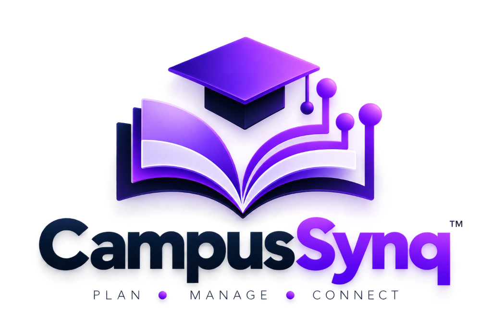

  # CampusSynq
  
  ### Academic Timetable & Resource Synchronization System
  
  *Enterprise-grade academic schedule coordination, facility allocation, faculty workload balancing, and real-time substitution management platform for university academic administration.*

  <p align="center">
    
    
    
    
    
    
    
    
  </p>

</div>

---

<a id="table-of-contents"></a>
## 📑 Table of Contents

- [🎯 Project Overview](#project-overview)
- [✨ Key Features by Role](#key-features)
  - [Department Administrator](#admin-features)
  - [Dean & Head of Department](#dean-features)
  - [Faculty Member](#faculty-features)
  - [Student Community](#student-features)
- [🖼️ Application Interface & Screenshots](#screenshots)
  - [Authentication & Access Gateways](#auth-screenshots)
  - [Department Administration Portal](#admin-screenshots)
  - [Dean Executive Oversight Portal](#dean-screenshots)
  - [Faculty Self-Service Portal](#faculty-screenshots)
- [🏗️ System Architecture](#system-architecture)
  - [Request Flow & Data Pipeline](#request-flow)
  - [Tri-Conflict Detection Engine](#tri-conflict-engine)
- [🛠️ Technology Stack](#technology-stack)
- [🔐 Role-Based Access Control & Security](#rbac-security)
- [📋 System Prerequisites](#prerequisites)
- [⚙️ Installation & Local Setup](#installation)
- [🔧 Environment Configuration](#environment-variables)
- [🗄️ Database Setup & Data Models](#database-setup)
- [🔌 Verified API Endpoints](#api-endpoints)
- [🧪 Automated Testing Suite](#testing)
- [🚀 Production Build & Deployment](#production-build)
- [📁 Repository Structure](#repository-structure)
- [🗺️ Known Limitations & Roadmap](#roadmap)
- [🤝 Contributing & License](#contributing-license)

---

<a id="project-overview"></a>
## 🎯 Project Overview

In complex university environments, managing academic schedules across multi-section cohorts, specialized computer laboratories, lecture halls, and faculty rosters creates critical administrative bottlenecks:

- **Fragmented Timetable Distribution:** Siloed paper timetables, spreadsheets, or stale PDF matrices lead to room conflicts, double-booking, and missed classes.
- **Facility Utilization Opacity:** Academic administrators struggle to instantly identify unoccupied lecture halls or laboratories in real time.
- **Faculty Availability Gaps:** Department heads lack immediate visibility into instructor teaching loads, free periods, and conflicting departmental commitments.
- **Manual, Uncoordinated Substitutions:** When faculty members take emergency leave, finding an available peer teaching the appropriate course requires manual phone calls and ad-hoc arrangements prone to collision.
- **Student Information Delays:** Cohorts frequently arrive at lecture halls only to discover room relocations or unnotified instructor absences.

**CampusSynq** eliminates these friction points through a centralized, reactive academic scheduling engine powered by Node.js, Express, and MongoDB, with real-time push synchronization via Server-Sent Events (SSE). It enforces mathematical non-collision constraints across faculty, physical rooms, and student sections while providing dedicated, role-specific portals tailored for each academic stakeholder.

---

<a id="key-features"></a>
## ✨ Key Features by Role

<a id="admin-features"></a>
### 1. Department Administrator (`ADMIN`)

The department administrator maintains full control over curricular master data and master scheduling:

- **Curricular Master Data Management:** Full CRUD operations for Semesters, Subjects, Class Sections, Classrooms, Computing Laboratories, and Auditoriums.
- **Referential Integrity Enforcement:** Active sessions protect dependent records; semesters, facilities, or faculty referenced in active timetable slots cannot be deleted.
- **Period & Timing Administration:** Configurable daily period slots with automatic 12-hour formatted time display (`h:mm A - h:mm A`) and strict sequence ordering.
- **Faculty Directory & Account Provisioning:** Registers faculty profiles, generates standardized `@campussynq.com` institutional emails with automated collision resolution (e.g., `dennis@campussynq.com`, `dennis01@campussynq.com`), provisions hashed temporary passwords, and triggers email credential dispatch.
- **Conflict-Free Timetable Synthesis:** Interactive schedule builder enforcing the Tri-Conflict Detection Engine across Day and Period combinations.
- **Department Metrics Dashboard:** High-level summary of total faculty, active sections, rooms, laboratories, and today's master lecture schedule.

<a id="dean-features"></a>
### 2. Dean & Head of Department (`DEAN`)

Designed for executive oversight and department-wide monitoring without modifying underlying master infrastructure:

- **Executive Academic Dashboard:** Real-time summary cards displaying active classes, occupied vs. free lecture halls, teaching faculty, and active substitutions.
- **Mode 1 — Class-Wise Occupancy Search:** Filter by Semester and Class Section to inspect complete weekly timetables, scheduled subjects, rooms, and instructors.
- **Mode 2 — Room-Wise Schedule Timeline:** Query any classroom, lab, or auditorium to inspect its full weekly booking schedule and current occupancy status.
- **Mode 3 — Faculty-Wise Schedule Query:** Inspect individual faculty workloads, assigned courses, active teaching slots, and free periods.
- **Mode 4 — Real-Time Free Room Inspector:** Instantly discover every currently unoccupied classroom, laboratory, or auditorium for an ad-hoc meeting, tutorial, or examination.
- **Mode 5 — Live Status Inspector:** Real-time departmental radar showing what is happening *right now* across all academic facilities and faculty.
- **Executive Substitution Center:** View, filter, approve, reject, or modify faculty substitution requests with live status propagation.
- **Multi-Entity Global Search:** Rapid search across faculty, subjects, rooms, and sections with instant auto-suggestions.

<a id="faculty-features"></a>
### 3. Faculty Member (`FACULTY`, `HOD_FACULTY`)

A dedicated portal focused on personal academic responsibilities and self-service flexibility:

- **Personalized Daily Dashboard:** Instant view of today's lecture schedule, room numbers, class sections, and period timings.
- **Weekly Schedule Matrix:** Comprehensive multi-day timetable grid highlighting assigned classrooms and laboratory sessions.
- **Self-Service Substitution Requests:** Request a peer to cover an upcoming lecture. The system automatically queries and displays only eligible, non-conflicting colleagues free during that specific day and period.
- **Substitution History & Tracking:** Track pending, approved, and rejected substitution requests with timestamps and administrator remarks.
- **Live Event Stream (SSE):** Automatic browser updates when timetables change or substitution approvals are processed.

<a id="student-features"></a>
### 4. Student Community (`STUDENT`)

Designed to deliver schedule transparency for enrolled cohorts:

- **Cohort Timetable Lookup:** Access section-specific weekly timetables, scheduled subjects, and faculty details.
- **Daily Lecture Tracking:** Immediate clarity on current period, next class, and allocated physical room or laboratory.
- **Substitution Awareness:** Visibility into approved faculty substitutions, preventing confusion when replacement instructors attend class.
- *Status:* RBAC role implemented and queryable via backend endpoints; dedicated standalone `/student/*` frontend portal interface is planned on the project roadmap.

---

<a id="screenshots"></a>
## 🖼️ Application Interface & Screenshots

> [!NOTE]
> Every screenshot below was captured directly from the live, running CampusSynq application using Playwright browser automation at 1440 × 900 desktop resolution with genuine academic test data.

<a id="auth-screenshots"></a>
### 1. Authentication & Access Gateways

#### Standard Split-Screen Login Gateway
*Unified authentication gateway for administrators and faculty members featuring institutional branding, secure credentials handling, and automatic role-based routing.*

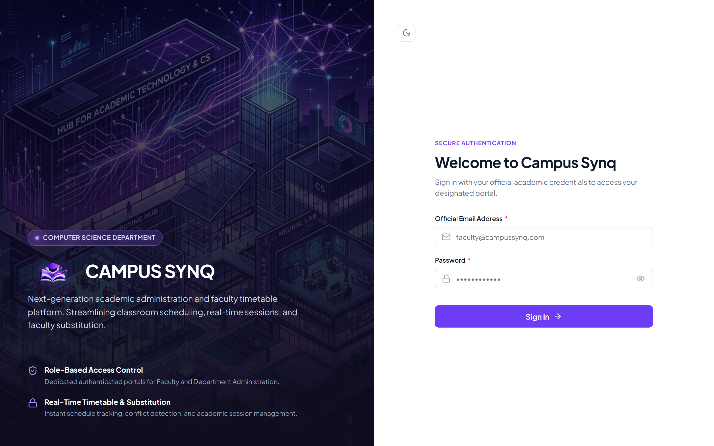

#### Dean Executive Login Portal
*Dedicated executive portal entrance for the Dean and Head of Department, styled in institutional midnight-navy with executive access credentials.*

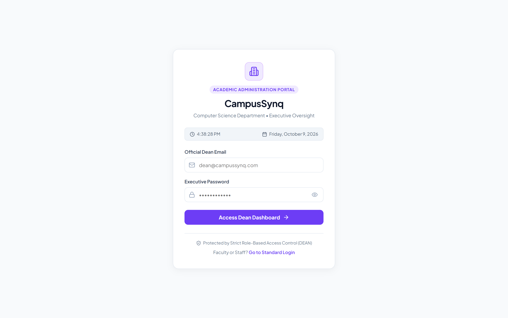

---

<a id="admin-screenshots"></a>
### 2. Department Administration Portal

#### Admin Metrics & Today's Master Schedule
*Central administrative hub showing total registered faculty, classrooms, computing labs, class sections, and today's live lecture matrix.*

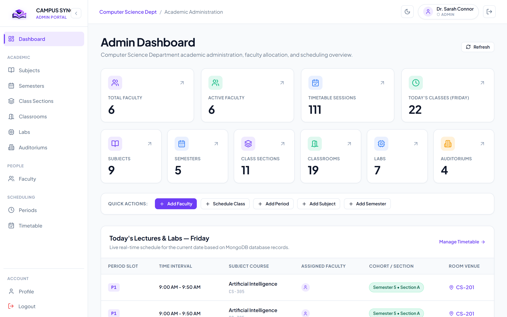

#### Faculty Directory & Automated Provisioning
*Administrative roster of departmental faculty with automated `@campussynq.com` email collision handling, designation tags, and on-demand credential dispatch triggers.*

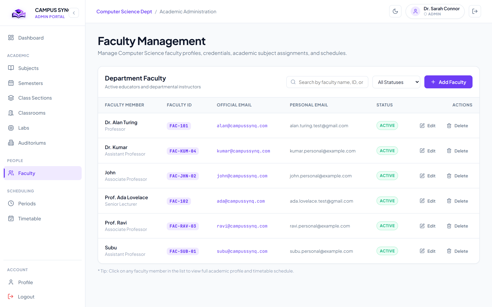

#### Master Timetable Administration Grid
*Interactive scheduling workspace where administrators construct cohort timetables with real-time tri-conflict validation preventing overlapping allocations.*

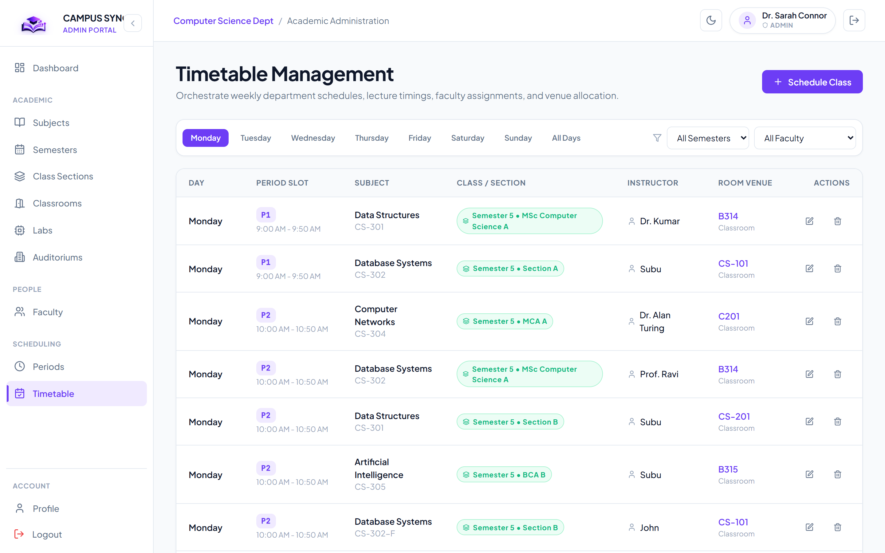

---

<a id="dean-screenshots"></a>
### 3. Dean Executive Oversight Portal

#### Executive Academic Dashboard
*Executive department overview displaying active lecture counts, room occupancy percentages, faculty teaching metrics, and today's schedule feed.*

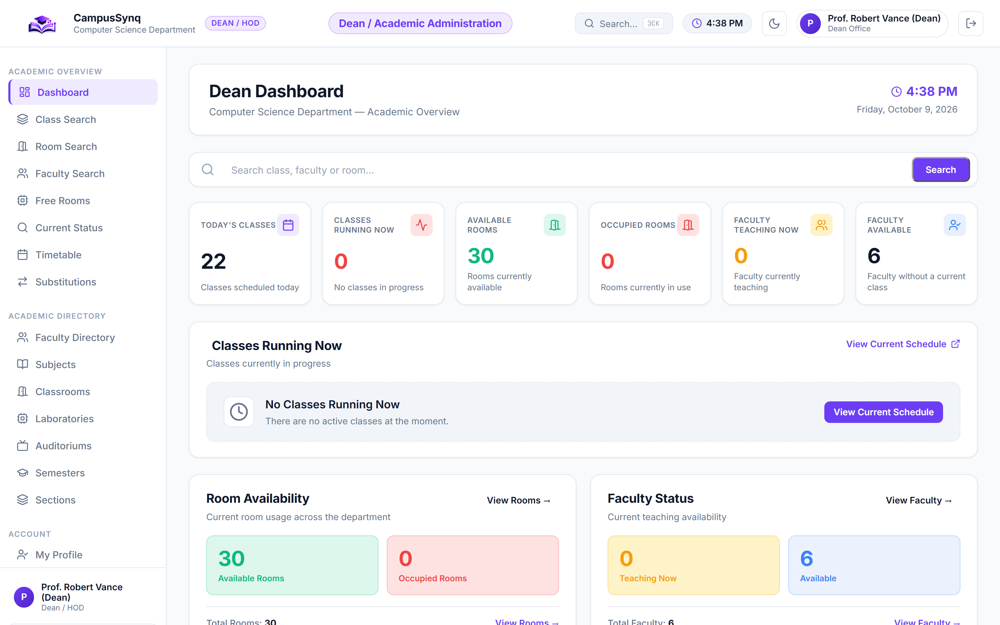

#### Mode 1 — Class-Wise Occupancy Search
*Search and view complete weekly academic schedules by semester and section, highlighting enrolled subjects, assigned faculty, and room locations.*

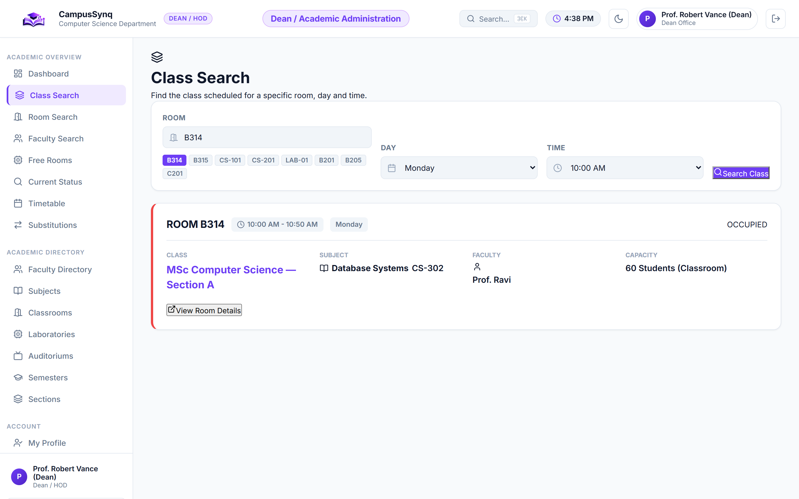

#### Mode 2 — Room-Wise Schedule Timeline
*Inspect physical facility utilization across classrooms, computing laboratories, and auditoriums to verify bookings across all weekdays.*

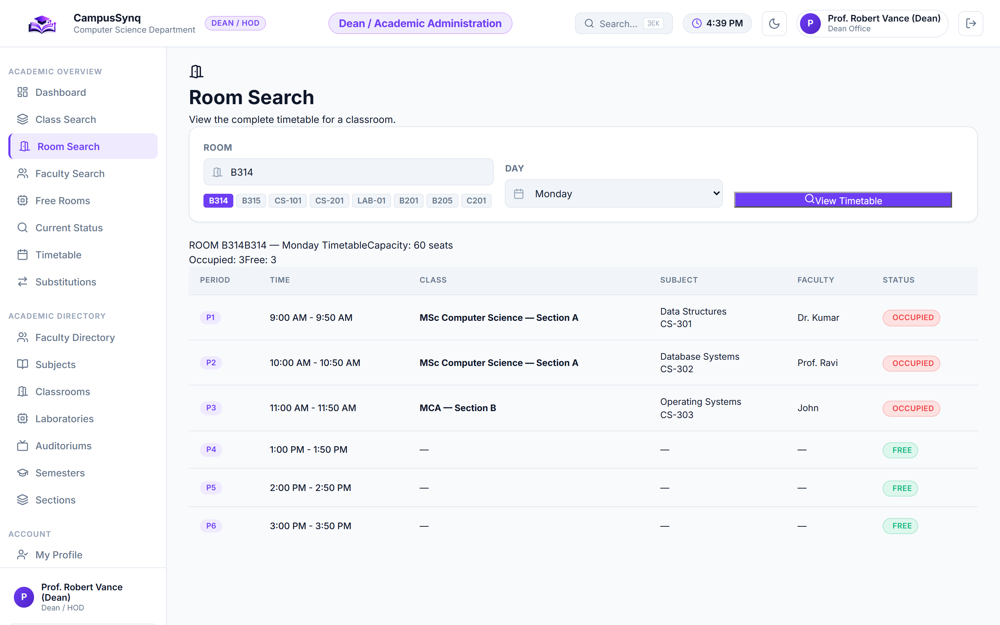

#### Mode 3 — Faculty-Wise Schedule Query
*Comprehensive query tool to analyze individual faculty teaching loads, assigned subjects, and weekly timetable distributions.*

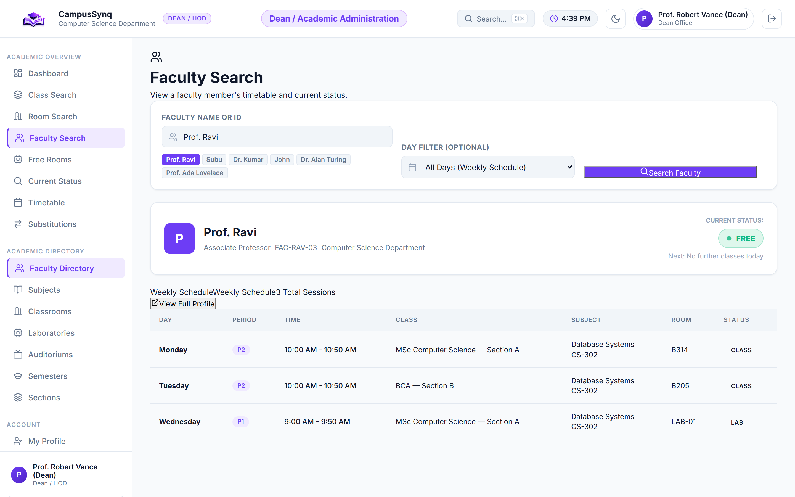

#### Mode 4 — Real-Time Free Room Inspector
*Instantly locate available classrooms, labs, and lecture halls for any selected day and period slot, complete with seating capacity and facility type.*

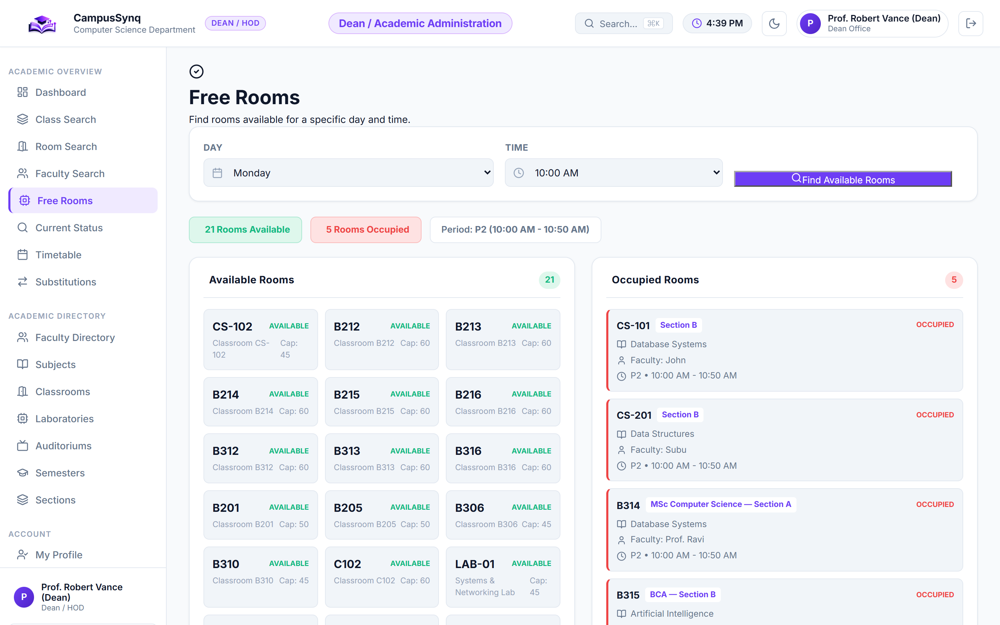

#### Mode 5 — Live Status Inspector
*Real-time department monitor identifying which classes are currently in session, which rooms are active, and which faculty are conducting lectures.*

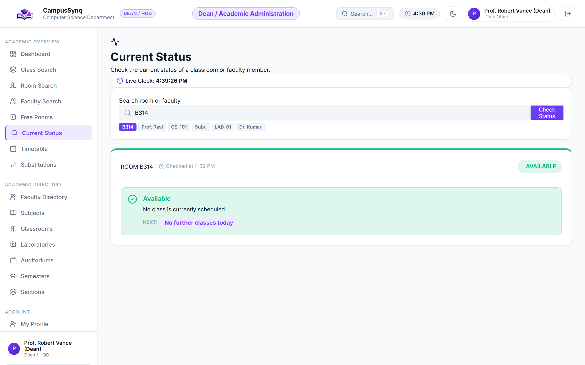

#### Dean Substitution Center
*Administrative workflow for reviewing faculty substitution requests, verifying conflict-free replacement candidates, and updating approval statuses.*

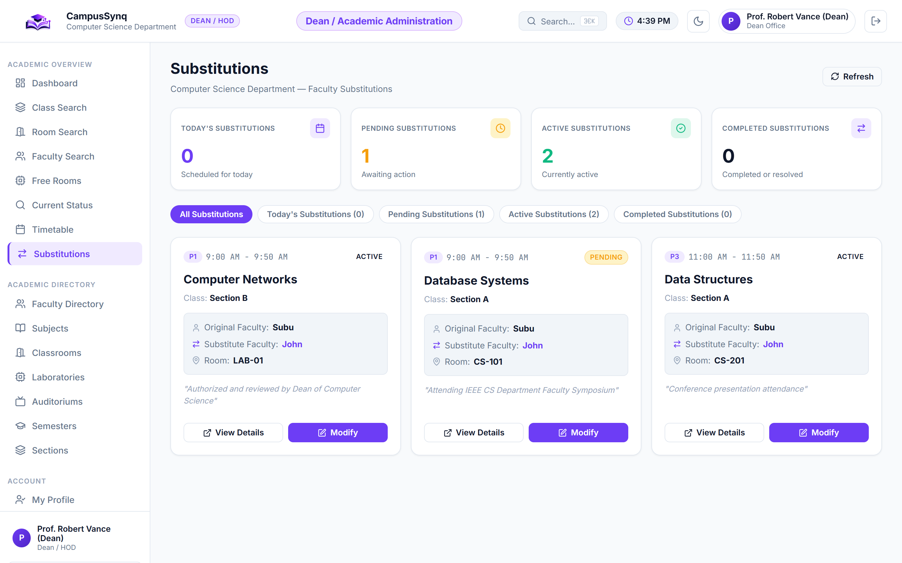

---

<a id="faculty-screenshots"></a>
### 4. Faculty Self-Service Portal

#### Faculty Personal Dashboard
*Individual instructor overview showing today's teaching agenda, upcoming lecture periods, assigned class sections, and quick substitution status cards.*

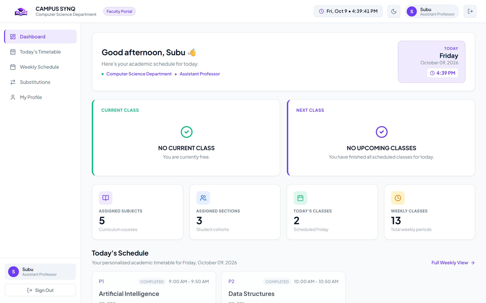

#### Faculty Weekly Schedule Matrix
*Personal weekly timetable grid mapping all teaching commitments across Monday through Saturday with period slots and room assignments.*

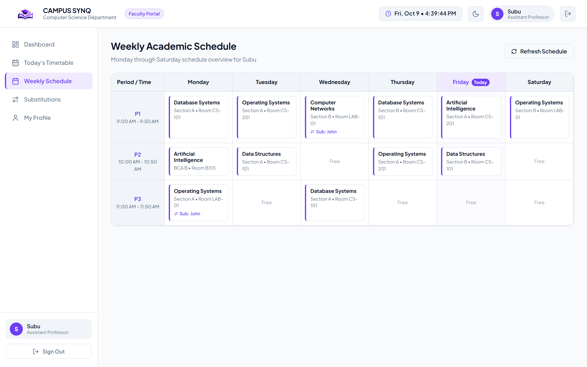

#### Self-Service Substitution Management
*Faculty portal interface for raising class coverage requests with automated conflict checks that only present available, non-busy colleagues.*

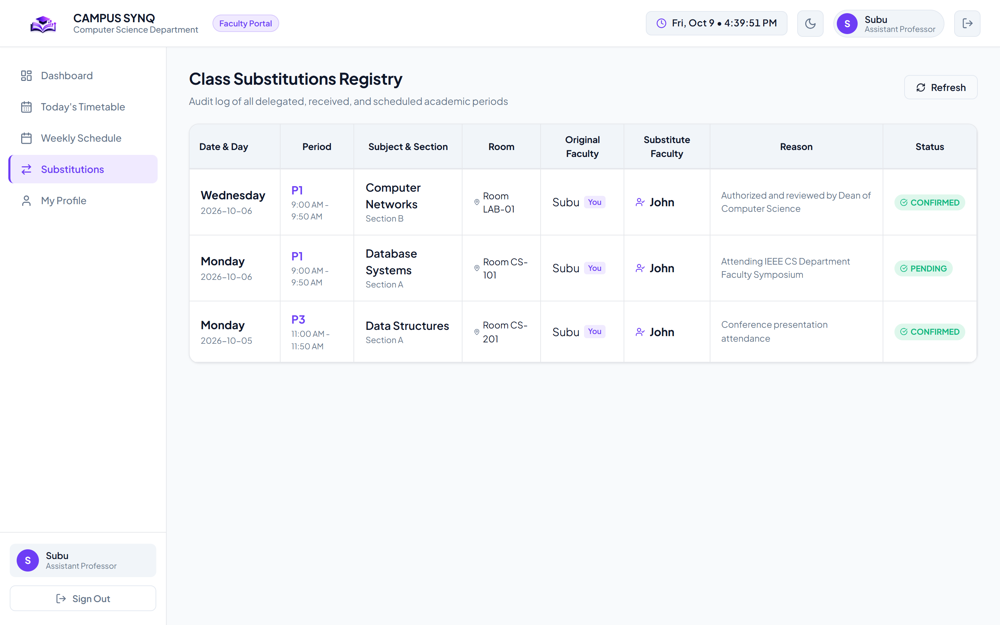

---

<a id="system-architecture"></a>
## 🏗️ System Architecture

CampusSynq is built as a decoupled client-server architecture. The browser Single Page Application communicates with the Node.js/Express API server via stateless HTTP REST requests and listens for real-time schedule updates over persistent Server-Sent Events (SSE).

```mermaid
flowchart TD
    subgraph Client["Frontend Client (React 18 + Vite)"]
        UI_Admin["Admin Portal (/admin/*)"]
        UI_Dean["Dean Oversight Portal (/dean/*)"]
        UI_Faculty["Faculty Portal (/faculty/*)"]
        SSE_Client["SSE Client Hook (EventSource)"]
    end

    subgraph Gateway["API Security & Middleware Layer"]
        RateLimiter["IP Rate Limiter"]
        Sanitizer["NoSQL Injection Sanitizer"]
        JWT_Auth["JWT Authentication (Bearer)"]
        RBAC["Role-Based Access Control"]
        Validator["express-validator Rules"]
    end

    subgraph Core["Backend Core (Express 4.21)"]
        AuthCtrl["Auth Controller"]
        MasterCtrl["Master Data Controllers"]
        FacultyCtrl["Faculty Controller & Emailer"]
        ConflictEngine["Tri-Conflict Detection Engine"]
        DeanCtrl["Dean Multi-Mode Search Engine"]
        SubCtrl["Substitution Workflow Controller"]
        EventEmitter["Node.js EventEmitter"]
    end

    subgraph DataStore["Persistence Layer (MongoDB 6.0+)"]
        Col_Admins[("Admins")]
        Col_Faculty[("Faculties")]
        Col_Facilities[("Classrooms / Labs / Auditoriums")]
        Col_Academics[("Semesters / Sections / Subjects")]
        Col_Timetable[("TimetableEntries (Unique Index)")]
        Col_Substitutions[("Substitutions")]
    end

    UI_Admin & UI_Dean & UI_Faculty --> RateLimiter
    RateLimiter --> Sanitizer --> JWT_Auth --> RBAC --> Validator
    
    Validator --> AuthCtrl & MasterCtrl & FacultyCtrl & ConflictEngine & DeanCtrl & SubCtrl
    
    ConflictEngine --> Col_Timetable
    MasterCtrl --> Col_Facilities & Col_Academics
    FacultyCtrl --> Col_Faculty
    DeanCtrl --> Col_Timetable & Col_Facilities
    SubCtrl --> Col_Substitutions
    
    ConflictEngine & SubCtrl -.->|Emit Academic Event| EventEmitter
    EventEmitter -.->|Push Stream (SSE)| SSE_Client
    SSE_Client -.->|Update State| UI_Dean & UI_Faculty
```

<a id="request-flow"></a>
### Request Flow & Data Pipeline

1. **Authentication:** Clients authenticate against `/api/v1/auth/login`. Credentials are verified against `bcryptjs` salted hashes. Successful authentication yields a signed JWT token containing user ID, email, role, and department.
2. **Authorization & RBAC:** Every protected route is guarded by `authMiddleware` (validating token signature and expiry) and `roleMiddleware(['ADMIN', ...])` (verifying role authorization).
3. **Validation & Sanitization:** All request payloads pass through NoSQL query operator sanitization (`$` prefix stripping) and declarative `express-validator` schema rules.
4. **Business Logic Execution:** Controllers coordinate operations with specialized services (e.g., automated email generation, password hashing, timetable slot verification).
5. **Real-Time Event Dispatch:** Write operations on timetables and substitutions emit departmental events (`TIMETABLE_CREATED`, `TIMETABLE_UPDATED`, `SUBSTITUTION_UPDATED`) through the central Node `EventEmitter`. Connected Dean and Faculty browser clients receive push updates over `/api/v1/dean/events` and `/api/v1/faculty/events` without polling.

<a id="tri-conflict-engine"></a>
### Tri-Conflict Detection Engine

The timetable scheduling service enforces mathematical exclusivity before persisting any session:

$$\text{TimetableEntry} = (\text{Day}, \text{Period}, \text{Faculty}, \text{Room}, \text{Section})$$

A new slot assignment is rejected with HTTP `409 Conflict` if any of the following conditions evaluate to true:

| Conflict Type | Evaluation Condition | Error Returned |
| :--- | :--- | :--- |
| **Faculty Double-Booking** | $\exists \text{ entry with } (\text{day}, \text{period}, \text{faculty} = F)$ | `409 Conflict: Faculty is already assigned to another lecture in this period.` |
| **Room Double-Booking** | $\exists \text{ entry with } (\text{day}, \text{period}, \text{room} = R)$ | `409 Conflict: Room is already booked for another session in this period.` |
| **Section Cohort Collision**| $\exists \text{ entry with } (\text{day}, \text{period}, \text{section} = S)$ | `409 Conflict: Section cohort already has a scheduled class in this period.` |

---

<a id="technology-stack"></a>
## 🛠️ Technology Stack

| Layer | Component / Package | Verified Version | Purpose |
| :--- | :--- | :---: | :--- |
| **Frontend Framework** | React | `^18.3.1` | Declarative component UI architecture |
| **Frontend Tooling** | Vite | `^6.0.1` | Ultra-fast development server & Rollup production bundler |
| **Client Routing** | React Router DOM | `^6.28.0` | Client-side routing with nested layouts and RBAC guards |
| **Icons & Design** | Lucide React | `^0.468.0` | Consistent SVG icon library |
| **Styling** | Vanilla CSS | Custom tokens | CSS custom properties, light/dark themes, glassmorphism UI |
| **Backend Runtime** | Node.js | `>= 18.0.0` | Asynchronous JavaScript server runtime |
| **API Framework** | Express | `^4.21.2` | RESTful routing, middleware orchestration, and SSE streaming |
| **Database** | MongoDB | `>= 6.0` | High-performance document database |
| **Database ODM** | Mongoose | `^8.9.5` | Schema validation, hooks, and relational query population |
| **Authentication** | JSON Web Tokens (`jsonwebtoken`) | `^9.0.2` | Stateless Bearer token generation and verification |
| **Password Security**| `bcryptjs` | `^2.4.3` | Salted credential hashing (work factor 10) |
| **Validation** | `express-validator` | `^7.2.1` | Schema sanitization and request body validation |
| **Email Service** | `nodemailer` | `^10.0.14` | Institutional faculty credential dispatch (SMTP / Mock) |
| **HTTP Logging** | `morgan` | `^1.10.0` | Development and production HTTP request logging |
| **Automated Testing**| Node Test Runner + `supertest` | `^7.0.0` | 101 automated integration, security, and unit tests |
| **Browser Testing** | Playwright Core | `^1.64.0` | Headless Chrome screenshot capture & UI automation |

---

<a id="rbac-security"></a>
## 🔐 Role-Based Access Control & Security

CampusSynq implements dual-layer role authorization. Access boundaries are enforced on the client via `ProtectedRoute` redirects and strictly guarded on the backend via Express middleware:

| Role Name | Scope Description | Accessible Portals | Backend Role Guards |
| :--- | :--- | :---: | :--- |
| **`ADMIN`** | Department Administrator with master data control, faculty provisioning, and scheduling authority. | `/admin/*` | `roleMiddleware(['ADMIN'])` |
| **`DEAN`** | Academic executive oversight; read-only department analytics, multi-mode facility searches, and substitution approval. | `/dean/*` | `roleMiddleware(['DEAN'])` |
| **`FACULTY`** | Department instructor with access to personal daily/weekly schedules and self-service substitution requests. | `/faculty/*` | `roleMiddleware(['FACULTY', 'HOD_FACULTY'])` |
| **`HOD_FACULTY`**| Head of Department with faculty teaching privileges. | `/faculty/*` | `roleMiddleware(['FACULTY', 'HOD_FACULTY'])` |
| **`STUDENT`** | Enrolled student with section timetable inspection access. | Timetable APIs | `roleMiddleware(['ADMIN', 'DEAN', 'FACULTY', 'STUDENT'])` |

### Security Measures

- **No Public Privileged Registration:** Administrative and Dean accounts cannot be registered publicly; they are provisioned through secure database seeding or existing administrator action.
- **Credential Sanitization:** Password hashes are flagged `select: false` on Mongoose models and never returned in API responses.
- **Deep Query Sanitization:** Incoming `req.body`, `req.query`, and `req.params` are scrubbed of MongoDB operator keys (`$gt`, `$ne`, etc.) to prevent NoSQL injection.
- **Rate Limiting:** Authentication routes (`/auth/login`, `/auth/signup`) enforce strict IP-based rate limiting to prevent brute-force attacks.
- **Security Headers:** Custom security middleware applies `X-Content-Type-Options: nosniff`, `X-Frame-Options: DENY`, `X-XSS-Protection: 1; mode=block`, and HSTS headers.
- **Graceful Shutdown:** Handles `SIGTERM` and `SIGINT` signals cleanly, draining existing requests and closing the MongoDB connection pool without data loss.

---

<a id="prerequisites"></a>
## 📋 System Prerequisites

Before running CampusSynq, ensure your local development machine meets the following requirements:

- **Node.js:** `v18.0.0` or higher (`v20.x` or `v22.x` recommended)
- **npm:** `v9.0.0` or higher
- **MongoDB:** MongoDB Community Server `v6.0` or higher running locally on port `27017` (or a reachable MongoDB Atlas connection URI)
- **Web Browser:** Google Chrome, Microsoft Edge, or Mozilla Firefox (modern Evergreen browser)

---

<a id="installation"></a>
## ⚙️ Installation & Local Setup

### 1. Clone the Repository

```bash
git clone <repository-url>
cd "CAMPUS SYNQ"
```

### 2. Install Dependencies

Install dependencies across the root project, backend, and frontend:

```bash
# Install root orchestration dependencies
npm install

# Install backend dependencies
cd backend && npm install

# Install frontend dependencies
cd ../frontend && npm install

# Return to root directory
cd ..
```

### 3. Configure Environment Variables

Create environment configuration files using the provided templates:

```bash
# Configure backend environment
cp backend/.env.example backend/.env

# Configure frontend environment (optional for local dev; uses Vite proxy)
cp frontend/.env.example frontend/.env
```

Review `backend/.env` to confirm database connection and authentication parameters:

```ini
PORT=5000
NODE_ENV=development
MONGODB_URI=mongodb://127.0.0.1:27017/campus_synq
JWT_SECRET=your_secure_development_secret_min_32_chars
JWT_EXPIRES_IN=7d
CLIENT_URL=http://localhost:5173
```

### 4. Ensure Local MongoDB is Running

Verify your local MongoDB service is active:

```bash
# Windows (PowerShell / Command Prompt)
net start MongoDB
# or verify port listener:
Test-NetConnection -ComputerName 127.0.0.1 -Port 27017

# macOS / Linux
brew services start mongodb-community
# or:
sudo systemctl start mongod
```

### 5. Launch the Application

CampusSynq includes a unified multi-process launcher that starts the Express API and Vite dev server concurrently, validates the database connection, and opens the application in your browser:

```bash
# Unified Node runner (Recommended across all operating systems)
node run.js

# Alternative root NPM script
npm run dev

# Windows Batch launcher
run.bat

# Windows PowerShell launcher
.\run.ps1
```

Alternatively, you can run each service independently in separate terminal tabs:

```bash
# Terminal 1: Start Backend Server
cd backend
npm run dev

# Terminal 2: Start Frontend Server
cd frontend
npm run dev
```

### 6. Access the Application

Once launched, access the application in your browser:

- **Main Application & Login:** `http://localhost:5173/login`
- **Dean Executive Portal:** `http://localhost:5173/dean/login`
- **Backend API Root:** `http://localhost:5000/api/v1`
- **Backend Health Check:** `http://localhost:5000/api/v1/auth/status`

---

<a id="environment-variables"></a>
## 🔧 Environment Configuration

### Backend Configuration (`backend/.env`)

| Variable | Required | Default / Example | Purpose |
| :--- | :---: | :--- | :--- |
| `PORT` | No | `5000` | Port on which the Express HTTP server listens |
| `NODE_ENV` | Yes | `development` / `production` | Execution environment mode |
| `MONGODB_URI` | Yes | `mongodb://127.0.0.1:27017/campus_synq` | MongoDB connection string URI |
| `JWT_SECRET` | Yes | `min_32_characters_secret` | Secret key used to sign and verify JSON Web Tokens |
| `JWT_EXPIRES_IN` | No | `7d` | Token validity duration (`1d`, `7d`, `24h`) |
| `CLIENT_URL` | No | `http://localhost:5173` | Allowed CORS origin for browser requests |
| `MAIL_HOST` | No | `smtp.example.com` | SMTP hostname for faculty credential email dispatch |
| `MAIL_PORT` | No | `587` | SMTP port (typically 587 for TLS, 465 for SSL) |
| `MAIL_USER` | No | `smtp_username` | SMTP authentication username |
| `MAIL_PASSWORD` | No | `smtp_password` | SMTP authentication password |
| `MAIL_FROM` | No | `"Campus Synq <admin@campussynq.edu>"` | Outgoing sender display name and email |

> [!TIP]
> When `MAIL_HOST` is not configured, CampusSynq's email service operates in safe development mode: outgoing faculty credential emails are logged directly to the backend console rather than failing.

### Frontend Configuration (`frontend/.env`)

| Variable | Required | Default / Example | Purpose |
| :--- | :---: | :--- | :--- |
| `VITE_API_URL` | No | *(empty)* | Optional absolute backend API URL. Leave blank in local development to use the relative Vite reverse-proxy path (`/api/v1`). |

---

<a id="database-setup"></a>
## 🗄️ Database Setup & Data Models

### Database Initialization

CampusSynq connects to MongoDB via Mongoose. In development mode (`NODE_ENV=development`), the backend server automatically runs the verification seeder (`backend/src/utils/seedFacultyData.js`) on startup.

The seeder verifies and idempotently initializes:
1. **Academic Periods:** Standard timing slots `P1` through `P6` with 12-hour presentation format.
2. **Semesters & Class Sections:** Sample Semester 5 with Section A and Section B cohorts.
3. **Physical Facilities:** Lecture Classrooms (CR-101, CR-102), Specialized Computing Laboratories (Lab-1, Lab-2), and Department Auditorium (Aud-1).
4. **Curricular Subjects:** Core Computer Science courses (Operating Systems, Database Systems, Computer Networks).
5. **Demonstration Accounts:** Seeded accounts for Admin, Dean, and Faculty members with associated lecture assignments.

In production mode (`NODE_ENV=production`), automatic seeding is disabled by default to protect production collections, unless explicitly enabled via `SEED_DEMO_DATA=true`.

### Key Collections & Schema Models

- **`Admin` (`models/Admin.js`):** Administrative user records with fields for `fullName`, `email`, hashed `password`, `role` (`ADMIN`, `DEAN`, `HOD_FACULTY`, `STUDENT`), `department`, and `status`.
- **`Faculty` (`models/Faculty.js`):** Faculty profiles with `facultyId`, `fullName`, `personalEmail`, official collision-handled `officialEmail`, `phone`, `designation`, `assignedSubjects`, and `assignedSections`.
- **`Period` (`models/Period.js`):** Schedule time slots with `periodNumber` (e.g. `P1`), `startTime`, `endTime`, `order`, and `status`.
- **`Semester` (`models/Semester.js`):** Academic terms with `name` (e.g. `Semester 5`), `academicYear`, and active status.
- **`ClassSection` (`models/ClassSection.js`):** Cohort sections with `name` (e.g. `Section A`), linked `semester`, and student `capacity`.
- **`Classroom` / `Lab` / `Auditorium`:** Room entities with `roomNumber` / `labNumber` / `auditoriumNumber`, `capacity`, and facility type.
- **`Subject` (`models/Subject.js`):** Academic courses with `code` (e.g. `CS501`), `name`, `credits`, `type` (`THEORY`, `PRACTICAL`), and linked `semester`.
- **`TimetableEntry` (`models/TimetableEntry.js`):** Core scheduling document joining `day`, `period`, `semester`, `classSection`, `subject`, `faculty`, and room reference with unique compound indexing.
- **`Substitution` (`models/Substitution.js`):** Records of faculty coverage requests with `originalFaculty`, `substituteFaculty`, `timetableEntry`, `date`, `status` (`PENDING`, `APPROVED`, `REJECTED`, `CANCELLED`), and audit history.

---

<a id="api-endpoints"></a>
## 🔌 Verified API Endpoints

All backend routes are mounted under `/api/v1` and return standardized JSON payloads:

```json
{
  "success": true,
  "message": "Operation successful",
  "data": { ... }
}
```

### 1. Authentication & Session (`/api/v1/auth`)

| Method | Endpoint | Purpose | Auth Required | Role Required |
| :--- | :--- | :--- | :---: | :---: |
| `GET` | `/auth/status` | System health check and initial admin existence verification | None | Public |
| `POST` | `/auth/signup` | First-time administrative account setup (rate limited) | None | Public |
| `POST` | `/auth/login` | Authenticate user credentials and issue signed JWT token | None | Public |
| `GET` | `/auth/me` | Fetch sanitized profile of currently authenticated user | Bearer JWT | Any valid role |
| `POST` | `/auth/logout` | Invalidate client session and clear authentication context | Bearer JWT | Any valid role |

### 2. Department Administration (`/api/v1/admin`)

| Method | Endpoint | Purpose | Auth Required | Role Required |
| :--- | :--- | :--- | :---: | :---: |
| `GET` | `/admin/dashboard` | Aggregated department statistics and today's schedule | Bearer JWT | `ADMIN` |
| `GET` / `POST` | `/admin/semesters` | List all semesters / Create a new academic semester | Bearer JWT | `ADMIN` |
| `PUT` / `DELETE` | `/admin/semesters/:id` | Update semester / Delete semester (guarded by integrity check) | Bearer JWT | `ADMIN` |
| `GET` / `POST` | `/admin/subjects` | List all subjects / Create a new course subject | Bearer JWT | `ADMIN` |
| `PUT` / `DELETE` | `/admin/subjects/:id` | Update subject / Delete subject (guarded) | Bearer JWT | `ADMIN` |
| `GET` / `POST` | `/admin/class-sections` | List class sections / Create a new section cohort | Bearer JWT | `ADMIN` |
| `GET` / `POST` | `/admin/classrooms` | List classrooms / Add a new classroom facility | Bearer JWT | `ADMIN` |
| `GET` / `POST` | `/admin/labs` | List computing labs / Register a new laboratory facility | Bearer JWT | `ADMIN` |
| `GET` / `POST` | `/admin/auditoriums` | List auditoriums / Register a new auditorium | Bearer JWT | `ADMIN` |
| `GET` / `POST` | `/admin/periods` | List timetable period slots / Create a new period | Bearer JWT | `ADMIN` |
| `PUT` / `DELETE` | `/admin/periods/:id` | Update period timing / Delete period (guarded) | Bearer JWT | `ADMIN` |
| `GET` / `POST` | `/admin/faculty` | List faculty directory / Register and provision faculty | Bearer JWT | `ADMIN` |
| `POST` | `/admin/faculty/:id/resend-credentials` | Resend official credentials to faculty's personal email | Bearer JWT | `ADMIN` |
| `GET` | `/admin/faculty/:id/timetable` | Fetch weekly timetable for a specific faculty member | Bearer JWT | `ADMIN` |
| `GET` / `POST` | `/admin/timetable` | List timetable slots / Create new slot (Tri-Conflict checked) | Bearer JWT | `ADMIN` |
| `PUT` / `DELETE` | `/admin/timetable/:id` | Update timetable slot / Delete scheduled session | Bearer JWT | `ADMIN` |
| `GET` | `/admin/timetable/today` | Fetch all master timetable entries scheduled for today | Bearer JWT | `ADMIN` |

### 3. Dean Executive Oversight (`/api/v1/dean`)

| Method | Endpoint | Purpose | Auth Required | Role Required |
| :--- | :--- | :--- | :---: | :---: |
| `GET` | `/dean/dashboard` | Executive summary cards and live academic schedule | Bearer JWT | `DEAN` |
| `GET` | `/dean/class-wise` | Mode 1: Search weekly timetable by semester and section | Bearer JWT | `DEAN` |
| `GET` | `/dean/room-wise` | Mode 2: Search weekly timetable for a specific room | Bearer JWT | `DEAN` |
| `GET` | `/dean/faculty-wise` | Mode 3: Search timetable by individual faculty member | Bearer JWT | `DEAN` |
| `GET` | `/dean/free-rooms` | Mode 4: Query all available, unoccupied rooms for a slot | Bearer JWT | `DEAN` |
| `GET` | `/dean/current-status` | Mode 5: Live department status across all rooms and faculty | Bearer JWT | `DEAN` |
| `GET` | `/dean/quick-search` | Typeahead suggestions for global search bar | Bearer JWT | `DEAN` |
| `GET` | `/dean/search` | Multi-entity global search across faculty, rooms, courses | Bearer JWT | `DEAN` |
| `GET` | `/dean/substitutions` | Substitution Center: List faculty substitution requests | Bearer JWT | `DEAN` |
| `GET` | `/dean/available-substitutes` | Query eligible, non-conflicting faculty for a slot | Bearer JWT | `DEAN` |
| `PUT` | `/dean/substitutions/:id` | Approve, reject, or modify substitution status | Bearer JWT | `DEAN` |
| `GET` | `/dean/events` | Server-Sent Events (SSE) stream for live timetable updates | Bearer JWT | `DEAN` |

### 4. Faculty Self-Service Portal (`/api/v1/faculty`)

| Method | Endpoint | Purpose | Auth Required | Role Required |
| :--- | :--- | :--- | :---: | :---: |
| `GET` | `/faculty/dashboard` | Personal dashboard summary, today's classes, stats | Bearer JWT | `FACULTY`, `HOD_FACULTY` |
| `GET` | `/faculty/timetable/today` | Personal timetable sessions scheduled for today | Bearer JWT | `FACULTY`, `HOD_FACULTY` |
| `GET` | `/faculty/timetable/weekly`| Complete personal weekly timetable matrix | Bearer JWT | `FACULTY`, `HOD_FACULTY` |
| `GET` | `/faculty/available-substitutes` | Query non-busy colleagues eligible for substitution | Bearer JWT | `FACULTY`, `HOD_FACULTY` |
| `GET` | `/faculty/substitutions` | View self-submitted substitution requests and status | Bearer JWT | `FACULTY`, `HOD_FACULTY` |
| `POST` | `/faculty/substitution` | Submit new class substitution request (conflict verified) | Bearer JWT | `FACULTY`, `HOD_FACULTY` |
| `GET` | `/faculty/events` | Server-Sent Events (SSE) stream for schedule alerts | Bearer JWT | `FACULTY`, `HOD_FACULTY` |

---

<a id="testing"></a>
## 🧪 Automated Testing Suite

CampusSynq includes a comprehensive automated test harness comprising 5 test suites and 101 individual integration, security, and unit tests executed via the native Node.js test runner (`node:test`) and `supertest`.

### Run the Test Suite

```bash
# Run all 5 test suites sequentially from the root
npm test

# Or run directly from backend directory
cd backend && npm test
```

### Verified Test Suite Breakdown

```
========================================================
✔ ALL 5 TEST SUITES PASSED CLEANLY (101/101 TESTS PASSED)
========================================================
```

1. **`tests/api.test.js` (17 tests):**
   - Health check and system readiness.
   - Authentication lifecycle (signup, login, sanitized `/auth/me`).
   - Master data CRUD for Semesters, Class Sections, Subjects, Classrooms, Labs, Auditoriums.
   - Referential integrity verification preventing orphan references.
2. **`tests/stage2.test.js` (16 tests):**
   - Period configuration and 12-hour formatted time serialization.
   - Automated faculty account provisioning and `@campussynq.com` email collision handling.
   - Tri-Conflict Timetable Engine validation (preventing faculty, room, and section collisions).
   - Deletion protection guards for faculty and period slots linked to active sessions.
3. **`tests/faculty_portal.test.js` (14 tests):**
   - Faculty authentication and RBAC boundary verification.
   - Personal today's schedule and weekly timetable endpoints.
   - Conflict-aware available substitute faculty query.
   - Self-service substitution request creation and validation.
   - Faculty Server-Sent Events (SSE) streaming connectivity.
4. **`tests/dean_portal.test.js` (29 tests):**
   - Dedicated Dean authentication and role authorization enforcement.
   - Executive dashboard analytics and live schedule feed.
   - Verification of all 5 Search Modes (Class-wise, Room-wise, Faculty-wise, Free rooms, Current status).
   - Multi-entity global search and quick-search auto-suggestions.
   - Master data oversight endpoints (read-only inspection of rooms, courses, faculty).
   - Substitution Center workflows (listing, filtering, modifying status, and SSE notification dispatch).
5. **`tests/stage3_e2e_integration.test.js` (25 tests):**
   - Master end-to-end integration and security audit.
   - Rejection of tampered and expired JWT tokens with HTTP 401.
   - Rate limiting and input sanitization verification.
   - Credential resend email dispatch triggers.
   - Full timetable collision matrix and clean session termination via `/auth/logout`.

---

<a id="production-build"></a>
## 🚀 Production Build & Deployment

### 1. Build Frontend Production Assets

Compile the React SPA into minified, production-ready static assets:

```bash
# From project root
npm run build

# Or directly in frontend directory
cd frontend && npm run build
```

Vite compiles optimized production assets to `frontend/dist/` (HTML, minified JavaScript chunks, and processed CSS). These assets can be served directly by Express in a monolithic deployment or hosted via Nginx, AWS S3 / CloudFront, or Cloudflare Pages.

### 2. Configure Backend Production Environment

Create a dedicated production environment file (`backend/.env`):

```ini
PORT=5000
NODE_ENV=production
MONGODB_URI=mongodb+srv://<db-user>:<db-password>@cluster0.mongodb.net/campus_synq?retryWrites=true&w=majority
JWT_SECRET=super_secure_production_secret_key_minimum_32_characters_long
JWT_EXPIRES_IN=7d
CLIENT_URL=https://campussynq.yourinstitution.edu
MAIL_HOST=smtp.sendgrid.net
MAIL_PORT=587
MAIL_USER=apikey
MAIL_PASSWORD=your_production_sendgrid_key
MAIL_FROM="CampusSynq Administration <noreply@yourinstitution.edu>"
```

### 3. Launch the Backend Server

Start the Node.js server in production mode:

```bash
cd backend
NODE_ENV=production node src/server.js
```

For production hosting, run the backend process under a process manager such as PM2 or within a Docker container:

```bash
# Using PM2
pm2 start src/server.js --name "campussynq-api" --instances max --env production
```

### 4. Production Security Checklist

- [x] Configure a cryptographically secure `JWT_SECRET` of at least 32 characters.
- [x] Set `NODE_ENV=production` to disable development seed overwrites and stack trace exposure.
- [x] Restrict `CLIENT_URL` to your production frontend domain to enforce strict CORS policy.
- [x] Enforce TLS / HTTPS at the reverse proxy (Nginx, Traefik, or Cloudflare).
- [x] Ensure MongoDB requires strong authentication and network isolation.

---

<a id="repository-structure"></a>
## 📁 Repository Structure

```
CAMPUS SYNQ/
├── backend/
│   ├── src/
│   │   ├── config/
│   │   │   ├── db.js                 # MongoDB connection and event lifecycle
│   │   │   └── env.js                # Environment variable validation & defaults
│   │   ├── controllers/
│   │   │   ├── authController.js     # Signup, Login, Me, Logout endpoints
│   │   │   ├── dashboardController.js# Admin dashboard aggregation
│   │   │   ├── deanController.js     # Dean 5-mode search, oversight, and SSE
│   │   │   ├── facultyController.js  # Faculty directory & credential triggers
│   │   │   ├── facultyPortalController.js # Faculty schedules, substitutions, SSE
│   │   │   ├── masterDataControllers.js   # Semesters, Subjects, Classrooms, etc.
│   │   │   ├── periodController.js   # Period slots management
│   │   │   └── timetableController.js# Timetable CRUD & conflict enforcement
│   │   ├── middleware/
│   │   │   ├── authMiddleware.js     # JWT Bearer token validation
│   │   │   ├── errorMiddleware.js    # Global error handler & formatting
│   │   │   ├── roleMiddleware.js     # Strict RBAC role enforcement
│   │   │   ├── securityMiddleware.js # Rate limiting & NoSQL sanitization
│   │   │   └── validateMiddleware.js # express-validator error catcher
│   │   ├── models/
│   │   │   ├── Admin.js              # Admin and executive user accounts
│   │   │   ├── Auditorium.js         # Auditorium facility schema
│   │   │   ├── ClassSection.js       # Student class section schema
│   │   │   ├── Classroom.js          # Lecture classroom facility schema
│   │   │   ├── Faculty.js            # Faculty profile and credentials schema
│   │   │   ├── Lab.js                # Computing laboratory facility schema
│   │   │   ├── Period.js             # Timetable period slot schema
│   │   │   ├── Semester.js           # Academic semester schema
│   │   │   ├── Subject.js            # Academic course subject schema
│   │   │   ├── Substitution.js       # Faculty substitution request schema
│   │   │   └── TimetableEntry.js     # Master timetable session schema
│   │   ├── routes/
│   │   │   ├── authRoutes.js         # /api/v1/auth routes
│   │   │   ├── deanRoutes.js         # /api/v1/dean routes
│   │   │   ├── facultyPortalRoutes.js# /api/v1/faculty portal routes
│   │   │   ├── facultyRoutes.js      # /api/v1/admin/faculty routes
│   │   │   ├── index.js              # Master route mounting & versioning
│   │   │   ├── periodRoutes.js       # /api/v1/admin/periods routes
│   │   │   └── timetableRoutes.js    # /api/v1/admin/timetable routes
│   │   ├── services/
│   │   │   ├── emailService.js       # Nodemailer credential dispatch
│   │   │   └── timetableConflictService.js # Tri-conflict detection logic
│   │   ├── utils/
│   │   │   ├── academicEvents.js     # Node EventEmitter for SSE broadcasts
│   │   │   ├── generateFacultyCredentials.js # Email & password generator
│   │   │   └── seedFacultyData.js    # Idempotent development data seeder
│   │   ├── validators/               # Input validation schemas
│   │   ├── app.js                    # Express application configuration
│   │   └── server.js                 # HTTP server entrypoint & graceful shutdown
│   ├── tests/
│   │   ├── api.test.js               # Stage 1 Master data & auth tests (17)
│   │   ├── stage2.test.js            # Stage 2 Timetable & conflict tests (16)
│   │   ├── faculty_portal.test.js    # Faculty portal & SSE tests (14)
│   │   ├── dean_portal.test.js       # Dean search & oversight tests (29)
│   │   ├── stage3_e2e_integration.test.js # Master E2E security tests (25)
│   │   └── run_all_tests.js          # Test suite orchestrator runner
│   ├── .env.example                  # Backend environment template
│   └── package.json                  # Backend dependencies & test scripts
├── frontend/
│   ├── public/
│   │   ├── logo.png                  # CampusSynq primary logo
│   │   └── logo-icon.png             # CampusSynq browser favicon
│   ├── src/
│   │   ├── api/                      # Axios / Fetch client and endpoint modules
│   │   ├── components/
│   │   │   ├── common/               # UI components (Button, Modal, Table, Skeleton)
│   │   │   └── layout/               # AdminLayout, DeanLayout, FacultyLayout, Guards
│   │   ├── context/
│   │   │   ├── AuthContext.jsx       # Global authentication state & methods
│   │   │   ├── ThemeContext.jsx      # Light / dark theme state management
│   │   │   └── ToastContext.jsx      # Global toast notification provider
│   │   ├── hooks/                    # Custom React hooks (useSSE, useDebounce)
│   │   ├── pages/
│   │   │   ├── auth/                 # LoginPage, SignupPage
│   │   │   ├── dashboard/            # Admin DashboardPage
│   │   │   ├── dean/                 # DeanDashboard, 5 Search Pages, Substitutions
│   │   │   ├── faculty/              # FacultyDashboard, Weekly, Substitutions
│   │   │   ├── masterData/           # Semesters, Subjects, Classrooms, Labs, etc.
│   │   │   ├── timetable/            # Admin TimetablePage
│   │   │   └── NotFoundPage.jsx      # 404 fallback page
│   │   ├── styles/                   # CSS design tokens, components, themes
│   │   ├── App.jsx                   # Master client routing configuration
│   │   └── main.jsx                  # React DOM root entrypoint
│   ├── .env.example                  # Frontend environment template
│   ├── index.html                    # HTML document template
│   ├── package.json                  # Frontend dependencies & Vite scripts
│   └── vite.config.js                # Vite build and proxy configuration
├── docs/
│   ├── screenshots/                  # 15 genuine application screenshot captures
│   │   ├── admin-dashboard.png
│   │   ├── admin-faculty.png
│   │   ├── admin-timetable.png
│   │   ├── dean-class-search.png
│   │   ├── dean-current-status.png
│   │   ├── dean-dashboard.png
│   │   ├── dean-faculty-search.png
│   │   ├── dean-free-rooms.png
│   │   ├── dean-login.png
│   │   ├── dean-room-search.png
│   │   ├── dean-substitutions.png
│   │   ├── faculty-dashboard.png
│   │   ├── faculty-substitutions.png
│   │   ├── faculty-weekly-timetable.png
│   │   └── login-page.png
│   └── ADMIN_STAGE_1_REPORT.md       # Master data and architecture report
├── scripts/
│   └── capture_screenshots.js        # Playwright automation screenshot script
├── .env.example                      # Root environment configuration template
├── package.json                      # Monorepo runner scripts & dev dependencies
├── run.js                            # Cross-platform Node process launcher
├── run.bat                           # Windows batch launcher
└── run.ps1                           # Windows PowerShell launcher
```

---

<a id="roadmap"></a>
## 🗺️ Known Limitations & Roadmap

### Implemented & Verified Functionality

- Full departmental master data management with deletion referential integrity guards.
- Dynamic period slots with 12-hour formatted time presentation.
- Automated faculty account generation with `@campussynq.com` collision handling and email dispatch.
- Tri-Conflict Timetable Engine preventing faculty, room, and section collisions.
- Dean Oversight Portal with 5 dedicated search modes and executive dashboard.
- Faculty Portal with personal daily and weekly timetable grids.
- Conflict-checked self-service faculty substitution workflow with Dean approval center.
- Real-time Server-Sent Events (SSE) notification streaming for Dean and Faculty clients.
- 101 automated unit, integration, and security tests (100% pass rate).
- Production build compilation with Vite.

### In Progress

- **WebSocket Bi-Directional Synchronization:** Transitioning from unidirectional Server-Sent Events (SSE) to full bi-directional WebSockets (`Socket.IO`) for instant live chat during substitution negotiations.
- **Automated Timetable Generation:** Genetic algorithm / constraint-satisfaction solver to auto-generate master timetables from subject loads and room capacities.

### Planned Features

- **Dedicated Student Self-Service Portal (`/student/*`):** While student cohort timetables are accessible via backend query endpoints, a dedicated responsive student portal with attendance tracking and personalized notification feeds is planned.
- **Calendar Synchronization (iCal / Google Calendar):** Export personal weekly schedules directly into external calendar applications.
- **Room Booking Requests for Extracurriculars:** Workflow for student clubs and academic societies to request auditorium or seminar hall reservations.
- **SMS / WhatsApp Alerts:** Instant urgent notifications for last-minute room changes or class cancellations.

---

<a id="contributing-license"></a>
## 🤝 Contributing & License

### Contributing

Contributions to CampusSynq are welcome. Please follow these guidelines:

1. Fork the repository and create a feature branch (`git checkout -b feature/academic-enhancement`).
2. Adhere to established project styling, architectural boundaries, and linting rules.
3. Write automated tests for any new endpoints or conflict validation rules.
4. Verify that all 101 existing tests pass cleanly (`npm test`).
5. Submit a detailed Pull Request describing changes and test results.

### License

CampusSynq is released under the **ISC License**.

Copyright © 2026 CampusSynq Team • Department of Computer Science.
